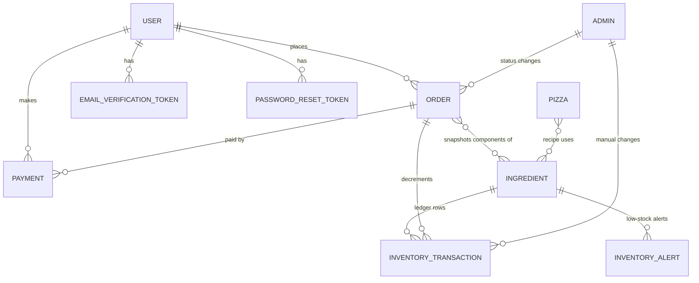

# DATABASE.md: Database Design and Backend Architecture

MongoDB 7 (Atlas or a local replica set) with Mongoose 8. Source files: `server/src/models/`.

## 1. Naming changes versus the TRD

The TRD was written first. These models replace its names, and where they differ **this document wins**.

| TRD name | Now | Why |
|---|---|---|
| `InventoryItem` | `Ingredient` | Matches the task and the domain |
| `StockLog` | `InventoryTransaction` | It is a ledger of stock transactions |
| `AlertLog`, `lowStockAlertedAt` field | `InventoryAlert` | Alert state lives in its own collection and drives de-duplication |
| `Order.payment{...}` (embedded) | `Payment` collection | Payment events and retries need their own record; `Order.payment` references it |
| `User.verifyTokenHash`, `resetTokenHash` fields | `EmailVerificationToken`, `PasswordResetToken` | Token history, attempt counts and automatic expiry |

## 2. Entity relationships



## 3. Collections

| Collection | Purpose | Key fields |
|---|---|---|
| `users` | Customers | `name`, `email` (unique), `phone`, `passwordHash` (hidden), `isVerified`, `addresses[]`, `passwordChangedAt` |
| `admins` | Operators (separate from users) | `email` (unique), `passwordHash` (hidden), `failedAttempts`, `lockedUntil`, `isActive` |
| `ingredients` | Stock items: base, sauce, cheese, veggie | `category`, `price` (paise), `quantity`, `threshold`, `unit`, `isActive` |
| `pizzas` | Ready-made recipes | `slug` (unique), `components{base,sauce,cheese,veggies[]}`, `priceOverride` |
| `orders` | Orders with frozen item snapshots | `orderNumber`, `items[]`, money fields, `status`, `statusHistory[]`, `payment`, `needsReview` |
| `payments` | Razorpay payment records | `razorpayOrderId` (unique), `razorpayPaymentId` (unique sparse), `razorpaySignature` (hidden), `amount`, `status` |
| `inventorytransactions` | Immutable stock ledger | `ingredient`, `type`, `quantityChange`, `quantityBefore`, `quantityAfter`, `order`, `admin`, `note` |
| `inventoryalerts` | Low-stock alert state | `ingredient`, `status` (open/resolved), `lastNotifiedAt`, `notifyCount` |
| `emailverificationtokens` | Email verification | `tokenHash`, `codeHash`, `codeAttempts`, `expiresAt`, `usedAt` |
| `passwordresettokens` | Password reset | `tokenHash`, `expiresAt`, `usedAt`, `requestedIp` |

## 4. Rules enforced by the schemas

- **Money is integer paise** (`paise()` field type rejects floats and negatives). `Order.total` must equal `subtotal + tax + deliveryFee + packagingFee`.
- **Stock is a non-negative integer.** Decrements also carry an atomic `quantity >= n` guard (`inventoryService.adjustStock`).
- **`InventoryTransaction` is append-only.** Update and delete operations throw, at the model level.
- **Order items are snapshots** (names and prices copied at order time). A `preset` item needs a `pizza`; quantity is 1 to 10.
- **Tokens are stored hashed (SHA-256)**, are single-use (atomic claim with `usedAt`), and expire. MongoDB TTL indexes delete expired rows. The 6-digit backup code allows 5 attempts.
- **One open alert per ingredient**, enforced by a partial unique index. Emails are sent only when `lastNotifiedAt` is empty or older than the cool-down.
- **Secrets never serialise:** `passwordHash` and `razorpaySignature` are `select: false` and removed from JSON output.

## 5. Indexes

| Collection | Index | Purpose |
|---|---|---|
| users | `email` unique | Login, duplicate check |
| admins | `email` unique | Login |
| ingredients | `{category, name}` unique; `{category, isActive}` | No duplicates; builder lists |
| pizzas | `slug` unique; `{isActive, tags}` | Menu filters |
| orders | `orderNumber` unique; `{user, createdAt}`; `{status, createdAt}`; partial `{needsReview}` | History, admin queues, flagged orders |
| payments | `razorpayOrderId` unique; `razorpayPaymentId` unique sparse; `{order}`; `{user, createdAt}`; `{status, createdAt}` | Verify, webhook, reports |
| inventorytransactions | `{ingredient, createdAt}`; `{order}` sparse; `{type, createdAt}` | Ledger filters |
| inventoryalerts | `{ingredient}` unique where `status=open`; `{status, lastNotifiedAt}` | De-duplication, due list |
| emailverificationtokens | `tokenHash` unique; `{user}`; `expiresAt` TTL | Lookup, cleanup |
| passwordresettokens | `tokenHash` unique; `{user}`; `expiresAt` TTL | Lookup, cleanup |

## 5b. Transactions

Paid-order confirmation (Phase 4) runs in one transaction: mark `Payment` paid, update the `Order`, then `decrementForOrder()` (one `Ingredient` update plus one `InventoryTransaction` per ingredient). Any shortage aborts the whole transaction. Transactions need a replica set: Atlas works, and the Docker service in `docker-compose.yml` is configured as one.

## 6. Backend architecture

```
server/
├── scripts/                  seedCatalogue.js, seedAdmin.js
├── tests/                    unit/ and integration/ (node:test, no extra dependencies)
└── src/
    ├── server.js             connect DB, start jobs, listen, graceful shutdown
    ├── app.js                middleware order, health checks, routes, error handling
    ├── config/               env.js (validated), db.js, logger.js
    ├── constants/            order statuses, inventory types, payment, auth lifetimes, error codes
    ├── models/               the ten Mongoose models + index.js
    ├── routes/               HTTP paths only; admin/ is behind adminAuth
    ├── controllers/          thin: read request, call a service, send JSON
    ├── services/             business rules (inventory, alerts, tokens, catalogue)
    ├── middleware/           requestId, validate, auth, adminAuth, rateLimit, notFound, errorHandler
    ├── validators/           Zod schemas for params, query and body
    ├── jobs/                 node-cron low-stock job
    └── utils/                ApiError, asyncHandler, tokens, jwt, money, pagination, transaction
```

Request flow: `route → rate limit → validate (Zod) → auth → controller → service → model`. Errors anywhere go to `errorHandler`.

### Middleware order in `app.js`

`requestId` → request logging → `helmet` → `cors` → *(Razorpay webhook with raw body, Phase 4)* → `express.json` → NoSQL sanitizer → `hpp` → health checks → `/api` (rate limited) → `notFound` → `errorHandler`.

### Centralized error handling

Every failure returns the same envelope:

```json
{ "error": { "code": "VALIDATION_ERROR", "message": "Validation failed",
             "details": [{ "path": "category", "message": "Invalid enum value" }],
             "requestId": "5b0e..." } }
```

| Thrown | Status | Code |
|---|---|---|
| `ApiError` (from services) | as set | as set (`OUT_OF_STOCK`, `INVALID_TRANSITION`, ...) |
| `ZodError` | 400 | `VALIDATION_ERROR` with field paths |
| Mongoose validation / cast error | 400 | `VALIDATION_ERROR` / `INVALID_ID` |
| Duplicate key (11000) | 409 | `DUPLICATE` naming the field |
| JWT expired / invalid | 401 | `TOKEN_EXPIRED` / `UNAUTHORIZED` |
| Bad JSON / too large | 400 / 413 | `INVALID_JSON` / `PAYLOAD_TOO_LARGE` |
| Anything else | 500 | `INTERNAL` (details hidden in production, logged with the request id) |

### Request validation

`validate({ params, query, body })` parses with Zod and replaces the request parts with the parsed values: types are coerced, defaults applied, unknown keys stripped. Schemas live in `validators/`.

### Endpoints available now

| Method and path | Notes |
|---|---|
| `GET /healthz`, `GET /readyz` | Liveness; readiness pings the database |
| `GET /api/ingredients?category=&search=&page=&limit=` | Active ingredients; shows `inStock`, never raw counts |
| `GET /api/pizzas?tag=&search=` | Active presets with computed `price` and `available` |
| `GET /api/admin/ping` | Admin token required (proves the admin guard) |

### What is intentionally not built yet

Auth routes and emails (Phase 1), admin inventory and order routes (Phase 2), orders and payments (Phase 4), Socket.IO (Phase 5), alert emails (Phase 6). Their models, services and middleware foundations exist: `tokenService`, `inventoryService`, `alertService`, `auth`, `adminAuth`.
