# Workflow.md: Forno & Farina Pizza Platform

End-to-end workflows for all 18 pages, based on the Stitch screens in `stitch_pizza_ordering_and_inventory_platform.zip`, the PRD and the TRD. Every flow names the screen, the user action, the API call, the result and the failure path.

Brand note: the screens use both "Forno & Farina" and "MyPizza". This document uses **Forno & Farina**; see `plan.md` §1.

---

## 1. Page and Route Map

| # | Page | Route | Role | Stitch screen folder(s) |
|---|---|---|---|---|
| 1 | Home | `/` | Public | `customer_home_page_artisanal_wood_fired_landing` |
| 2 | Register | `/register` | Public | `customer_registration_page_1`, `_2` |
| 3 | Email verification | `/verify-email` | Public | `customer_email_verification_page` |
| 4 | Login | `/login` | Public | `customer_login_page_1`, `_2` |
| 5 | Forgot password | `/forgot-password` | Public | `customer_forgot_password_page_1`, `_2` |
| 6 | Reset password | `/reset-password?token=` | Public | `customer_reset_password_page` |
| 7 | Customer dashboard | `/dashboard` | User | `customer_dashboard_artisanal_menu_7`, `customer_menu_dashboard` |
| 8 | Pizza builder | `/builder` | User | `custom_pizza_builder_4_step_wizard`, `custom_pizza_builder_page_8` |
| 9 | Order summary and checkout | `/checkout` | User | `order_summary_checkout_page`, `order_summary_razorpay_checkout_modal` |
| 10 | Order tracking and history | `/orders`, `/orders/:id` | User | `order_tracking_history_page`, `live_customer_order_tracking_screen` |
| 11 | User profile | `/profile` | User | `customer_profile_saved_addresses_page_11` |
| 12 | Admin login | `/admin/login` | Public (unlinked) | `admin_secure_login_page` |
| 13 | Admin dashboard | `/admin` | Admin | `admin_dashboard_hearth_operations_hub`, `admin_inventory_order_management_dashboard`, `admin_dashboard_manual_stock_update_thresholds_control`, `admin_dashboard_post_restock_collision_resolved_ff_8909` |
| 14 | Inventory management | `/admin/inventory` | Admin | `admin_inventory_management_page` |
| 15 | Add/Edit inventory item | `/admin/inventory/new`, `/admin/inventory/:id/edit` | Admin | `admin_add_edit_inventory_item_page` |
| 16 | Order management | `/admin/orders` | Admin | `admin_order_management_page` |
| 17 | Order details | `/admin/orders/:id` | Admin | `admin_order_details_page` |
| 18 | Inventory transactions and low-stock alerts | `/admin/ledger` | Admin | `inventory_transactions_low_stock_alerts_page`, `admin_stock_adjustment_audit_trail_modal` |

---

## 2. Global Rules

### 2.1 Roles and guards

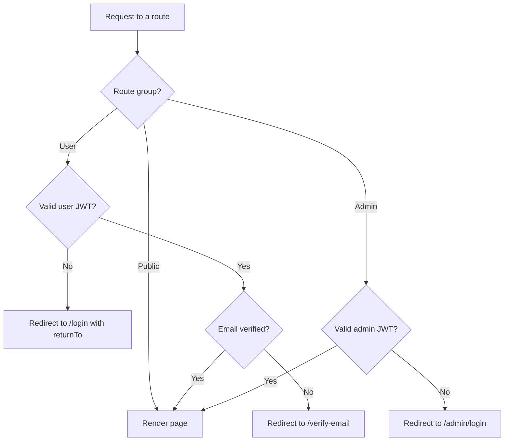

- Guards in React are only for UX. The server re-checks every request (user token vs admin token use different secrets and audiences).
- `/admin/*` is never linked from the customer UI. The customer login screen variant that shows an "Admin Hearth Terminal" link should **not** be used (see `plan.md`).
- A `401` anywhere clears the session and redirects to the matching login.

### 2.2 Shared header behavior (customer)

| Element | Behavior |
|---|---|
| Menu | Scrolls to or opens `/dashboard` menu section |
| Build Custom | Opens `/builder` |
| Active Orders (with LIVE count badge) | Opens `/orders`; badge = count of orders in Received / In Kitchen / Sent to Delivery, updated by socket |
| Cart (n) | Opens `/checkout`; cart is held client-side and persists across reloads |
| Notification bell | Shows order status changes from the current session |
| Deliver to | Shows default saved address; click opens address picker |
| Account icon | Profile, sign out |

### 2.3 State machines

**Account**
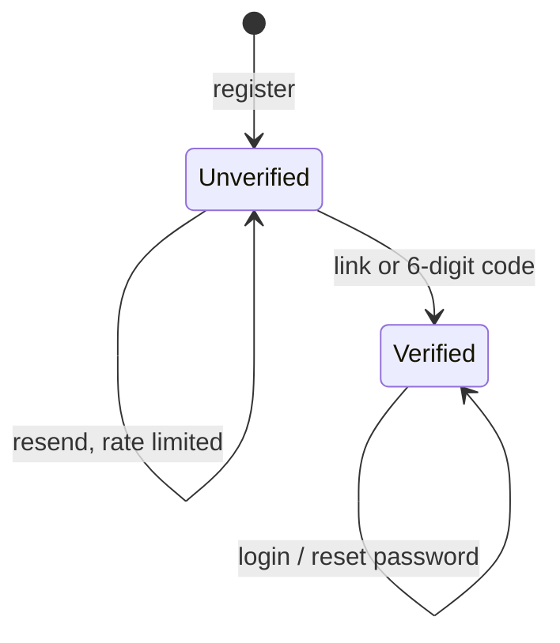

**Order**
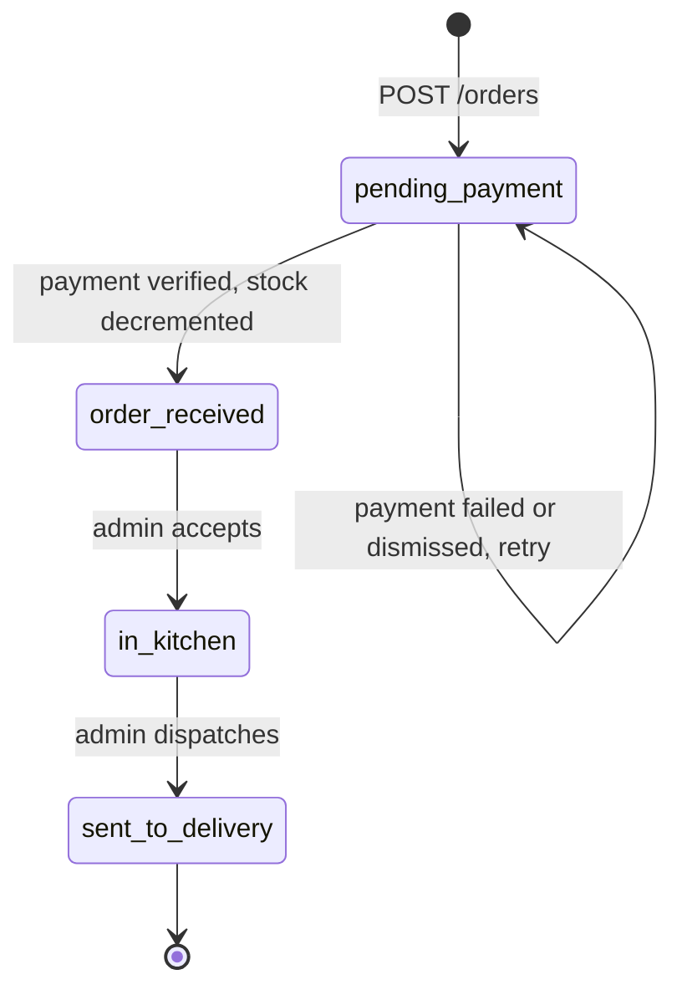
Only forward transitions are allowed. Customer-facing labels: **Order Received → In Kitchen → Sent to Delivery**.

**Inventory item status** (derived): `OK` when quantity ≥ threshold, `Low` when 0 < quantity < threshold, `Out` when quantity = 0.

---

## 3. Customer Workflows

### 3.1 Onboarding (pages 1, 2, 3, 4)

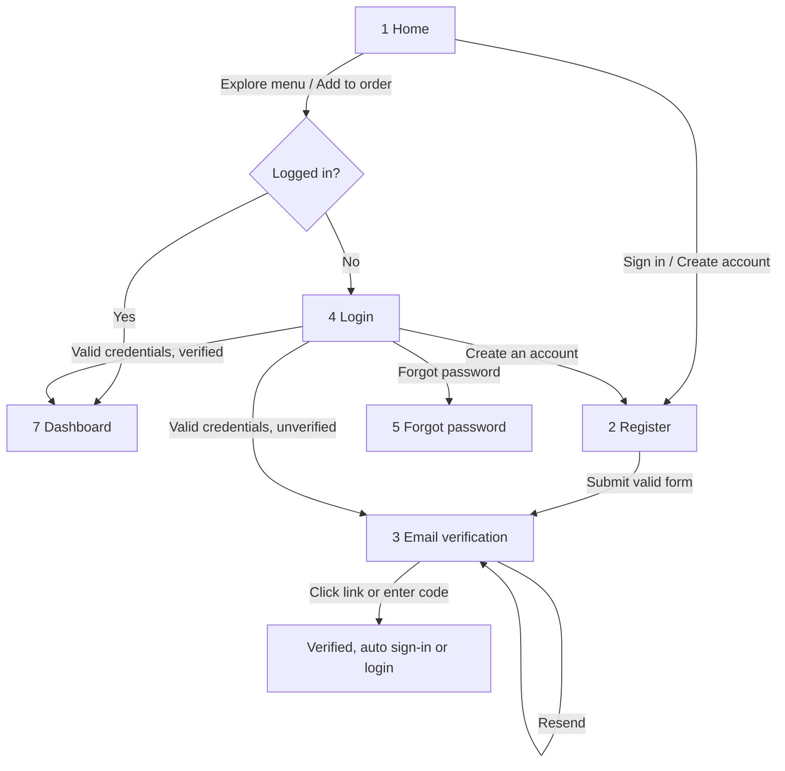

**Page 1: Home**

| Step | Action | System response |
|---|---|---|
| 1 | Open `/` | Loads featured pizzas (`GET /pizzas`), hero, philosophy sections |
| 2 | Filter chips (All, Red, White, Truffle) | Client-side filter on loaded pizzas |
| 3 | Add to order (guest) | Item stored in the local cart, then redirect to `/login?returnTo=/dashboard` on checkout |
| 4 | Build Custom Pizza | Navigates to `/builder` (guest redirected to login first) |
| 5 | Track Active Order banner | Shown only when logged in and an active order exists |

**Page 2: Register**

| Step | Action | System response |
|---|---|---|
| 1 | Enter name, email, phone (variant 2), password, confirm password, accept terms | Inline validation: email format, password rules, match, terms checked |
| 2 | Submit | `POST /auth/register` creates an unverified user and sends the verification email |
| 3 | Success | Navigate to `/verify-email` showing the masked email |
| Failure | Email already used | Field error "An account with this email already exists", link to Login |
| Failure | Server or email error | Toast with retry; account is still created, the user can use Resend |

**Page 3: Email verification**

| Step | Action | System response |
|---|---|---|
| 1 | Land on page (after register or login-while-unverified) | Shows email address, countdown "token expires in 23h 48m", Resend button with cooldown |
| 2a | Click the emailed link `/verify-email?token=…` | `GET /auth/verify-email?token=` marks verified, then continues to dashboard |
| 2b | Enter 6-digit backup code and confirm | `POST /auth/verify-code` (same effect as the link) |
| 3 | Resend (after cooldown, e.g. 60 s) | `POST /auth/resend-verification`; generic success message; button disabled during cooldown |
| 4 | Wrong address? Update email | Allowed only while unverified; `PATCH /auth/email` then new verification email |
| Failure | Token expired or used | Page shows "Link expired" with Resend |

**Page 4: Login**

| Step | Action | System response |
|---|---|---|
| 1 | Enter email, password, optional Remember me | Client validation |
| 2 | Submit | `POST /auth/login` |
| 3 | Verified | JWT stored; redirect to `returnTo` or `/dashboard`. Remember me selects the longer token lifetime |
| 3b | Unverified | `403 EMAIL_NOT_VERIFIED`; redirect to `/verify-email`; Resend link offered on the login page |
| Failure | Wrong credentials | Generic "Invalid email or password"; rate limited after repeated attempts |
| Links | Forgot password, Create account | Navigate to pages 5 and 2 |

### 3.2 Password recovery (pages 5, 6)

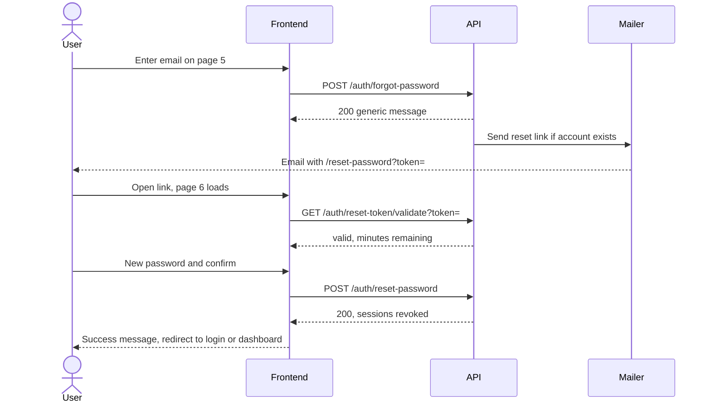

| Page | Behavior |
|---|---|
| 5 Forgot password | One email field. Submit always shows the same confirmation, whether or not the account exists. Resend button shows a cooldown (for example "Resend in 58s"). "Back to Login" returns to page 4 |
| 6 Reset password | Shows "token verified, N minutes remaining" if valid. Live strength meter and checklist (length, upper and lower case, number, special symbol), match indicator, "Revoke all active sessions" checkbox (default on). Invalid or expired token shows an error with a link back to page 5. Success sets `passwordChangedAt`, invalidating older JWTs |

### 3.3 Order journey (pages 7, 8, 9, 10)

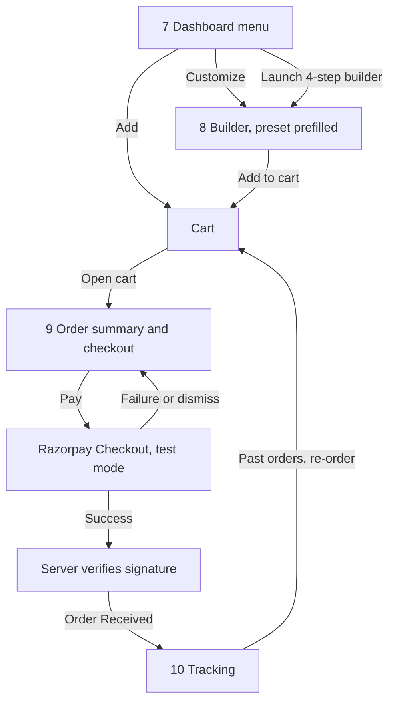

**Page 7: Customer dashboard**

| Section | Behavior |
|---|---|
| Greeting and CTA | "Welcome back, {name}" and Launch 4-Step Builder |
| Filters | Category tabs, search, dietary toggles (Vegetarian, Spicy, Gluten-friendly where data exists) |
| Pizza cards | Image, name, description, price. **Add** puts one unit in the cart. **Customize** opens the builder prefilled. Cards whose components are out of stock show "Unavailable" and a disabled Add |
| Active order strip | If an order is active, shows status and "Track live" |
| Recent orders | Last orders with **View receipt** and **Re-order** |

Data: `GET /pizzas`, `GET /orders/active`, `GET /orders/mine?limit=3`.

**Page 8: Pizza builder (4 steps)**

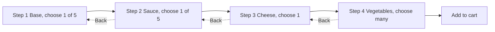

| Rule | Detail |
|---|---|
| Option data | `GET /ingredients?category=` for each step |
| Next button | Disabled until the step's required choice is made (vegetables are optional) |
| Out-of-stock | Option card disabled with an "Out of stock" label |
| Order breakdown panel | Running list of selections and live price computed from catalogue prices |
| Selections | Kept in builder state when moving back and forth |
| Final step | Quantity stepper, then **Add to cart** creates a `custom` line item (ids only) and goes to `/checkout` or back to the menu |
| Optional | "Save to My Custom Creations" stores a reusable recipe (see `plan.md`, deferred) |

**Page 9: Order summary and checkout**

| Step | Action | System response |
|---|---|---|
| 1 | Open `/checkout` | Shows cart items with quantity steppers and Remove; delivery address (default or change); drop-off and kitchen instructions; bill summary (subtotal, packaging/delivery, tax, total) |
| 2 | Change address | Opens saved addresses from page 11 or an inline add form |
| 3 | Edit quantities or remove | Totals recalculated client-side for display only |
| 4 | Click **Pay ₹…** | `POST /orders` re-validates stock and recomputes the price on the server, creates the order (`pending_payment`) and a Razorpay order |
| 5 | Razorpay modal opens | Test mode. User picks **Success** or **Failure** |
| 6a | Success | Frontend sends `razorpay_order_id`, `payment_id`, `signature` to `POST /payments/verify` |
| 7a | Verified | Server marks paid, sets **Order Received**, decrements stock, emits socket events, sends confirmation email. UI navigates to `/orders/:id` |
| 6b | Failure or dismiss | Order remains `pending_payment`, no stock used, toast "Payment not completed", user stays on page 9 and can retry |
| Failure | `409 OUT_OF_STOCK` at step 4 | Inline message listing the affected items and a prompt to remove or swap them |
| Failure | `409 STOCK_CONFLICT_AFTER_PAYMENT` | Message that the order needs attention; admin is alerted (flagged order) |

**Page 10: Order tracking and history**

Two tabs: **Active order tracking** and **Past order history**.

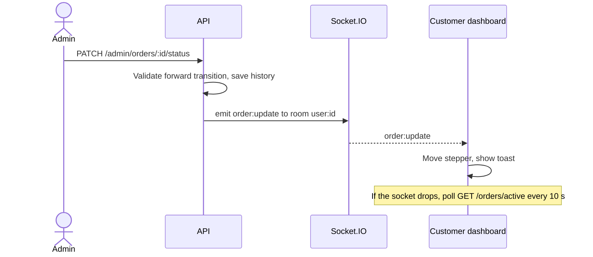

| Element | Behavior |
|---|---|
| Status stepper | Order Received → In Kitchen → Sent to Delivery with a timestamp on each completed step; current step highlighted |
| ETA | Simple estimate from configured prep and delivery minutes plus status timestamps (informational only) |
| Itemized manifest | Items, components, total, payment reference |
| Actions | Share tracking link, download tax invoice, support/hotline contact (see `plan.md` for what is in v1) |
| Past orders | Filter chips (All, Delivered, Custom builds, Past 30 days); **View invoice**; **Re-order in 1-click** copies the items into the cart after re-validating availability |
| Empty state | "No active orders. Browse the menu" |

### 3.4 Profile (page 11)

| Section | Actions | API |
|---|---|---|
| Personal information | Inline edit name, phone; save or discard | `PATCH /users/me` |
| Saved delivery addresses | Add, edit, remove, set default; label Home/Work/Other; courier instructions | `GET/POST/PATCH/DELETE /users/me/addresses` |
| Crust and dietary presets | Save preferences used to prefill filters | `PATCH /users/me/preferences` (deferred, `plan.md`) |
| Security | Change password (current + new); sign out of all other sessions | `POST /auth/change-password` |
| Payment methods | Informational ("handled by Razorpay"); no card storage | None |
| Active orders and re-order | Link to page 10 | None |
| Sign out | Clears token and cart-independent session data | None |

---

## 4. Admin Workflows

### 4.1 Admin login (page 12)

| Step | Action | System response |
|---|---|---|
| 1 | Open `/admin/login` (typed or bookmarked; no link from customer UI) | Restricted-access screen |
| 2 | Enter admin email or operator id and password | `POST /admin/auth/login` |
| 3 | Success | Admin JWT (short lifetime) stored; redirect to `/admin` |
| Failure | Wrong credentials | Generic "Invalid credentials" |
| Failure | 5 failed attempts | Account locked for 15 minutes with a clear message |
| Not in v1 | TOTP and FIDO2 options shown in the design | Hidden or disabled (see `plan.md`) |

### 4.2 Admin dashboard (page 13)

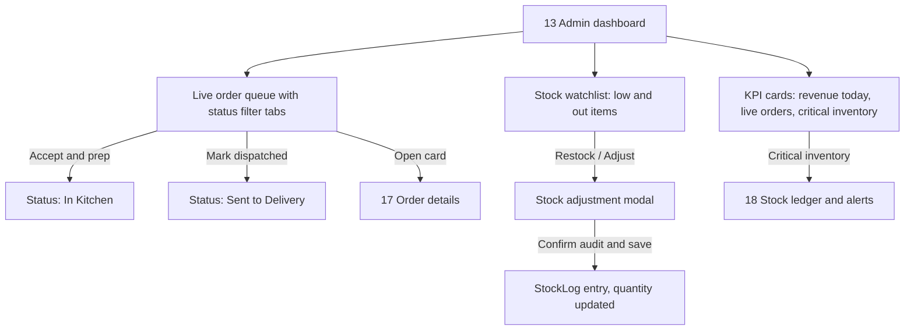

| Element | Behavior |
|---|---|
| KPI cards | Revenue today (sum of paid orders), live orders by stage, count of items below threshold. Served by `GET /admin/dashboard/summary` |
| Live queue | New paid orders appear instantly (`order:new`) with an optional sound (toggle "Incoming alert: ON"). Filter tabs: All, Received, Kitchen, Delivery |
| Action buttons | One primary button per order that advances to the next valid status. Button disabled while the request is in flight; failure rolls back the optimistic UI |
| Stock watchlist | Items sorted by severity: Out, Low, then OK. Updates on `inventory:update` |
| Header status | Socket connected indicator, notification bell, operator name, sign out |
| Quick adjust modal | Delta (+/-) or exact count, reason, optional PO or lot id; see 4.4 |

### 4.3 Inventory management and item editor (pages 14, 15)

**Page 14: Inventory management**

| Step | Action | System response |
|---|---|---|
| 1 | Open `/admin/inventory` | Table of all items with category tabs (Bases, Sauces, Cheeses, Vegetables), search, status chips, quantity vs threshold |
| 2 | Quick restock / Adjust stock | Opens the stock adjustment modal (4.4) |
| 3 | Edit | Opens page 15 for that item |
| 4 | Add new ingredient | Opens page 15 in create mode |
| 5 | Export CSV | Downloads the current filtered list |
| 6 | Run stock audit | Triggers the low-stock check immediately (`POST /admin/alerts/run`) and shows a result toast |

**Page 15: Add/Edit inventory item**

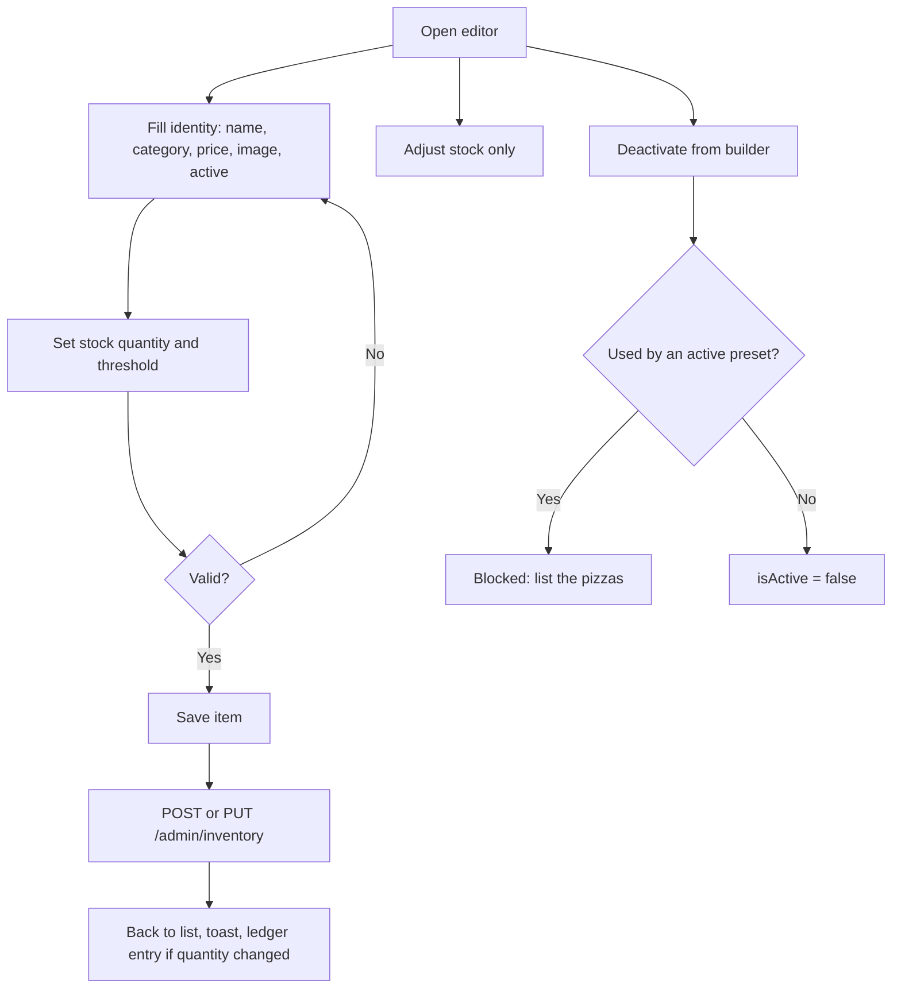

| Field group | Fields |
|---|---|
| Identity | Name, category, description, image, dietary tags, active flag |
| Stock rules | Quantity, unit, threshold (configurable per item), reorder note |
| Supply info (optional) | Supplier, storage notes, lot id |
| Side panel | Recent stock adjustments for this item (last entries from `StockLog`) |

Rules: category is fixed after creation if the item is used in orders; quantity cannot be negative; duplicate name within a category is rejected.

### 4.4 Stock adjustment (modal, used from pages 13, 14, 18)

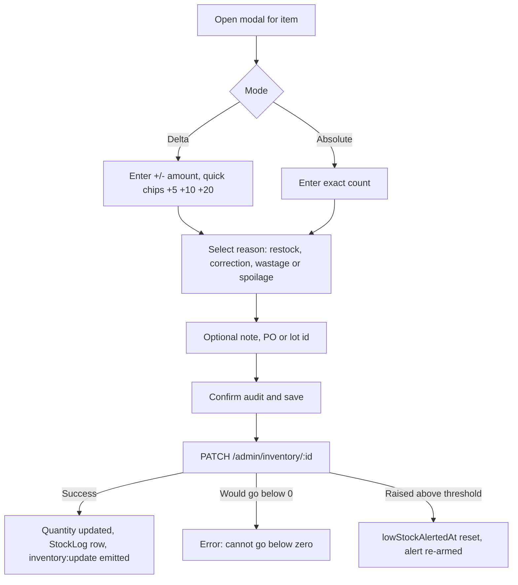

The modal also shows recent audit rows and the item's threshold. Threshold edits happen here or on page 15.

### 4.5 Order management and details (pages 16, 17)

**Page 16: Order management**

| Step | Action | System response |
|---|---|---|
| 1 | Open `/admin/orders` | Table or card list, newest first, with status tab counts (All, Order Received, In Kitchen, Sent to Delivery) and pagination |
| 2 | Search / filter | Order id, customer, phone, pizza; date range |
| 3 | Primary row action | "Move to Kitchen" (Received → In Kitchen) or "Mark Dispatched" (In Kitchen → Sent to Delivery) |
| 4 | Open order | Navigates to page 17 |
| 5 | New order arrives | Row inserted at the top with a highlight; tab counts update |
| Failure | Invalid or concurrent transition | `409 INVALID_TRANSITION`; row refreshes to the current status |

**Page 17: Order details**

| Section | Content |
|---|---|
| Header | Order id, status badge, timestamps |
| Items and kitchen spec | Each pizza with full component list, quantity, notes and allergy instructions |
| Financials | Subtotal, tax, delivery, total, Razorpay order and payment ids, verification state |
| Customer and delivery | Name, phone (call link), address, drop-off instructions |
| Status audit trail | `statusHistory` with timestamp and admin |
| Actions | **Advance status** (single forward button), Print kitchen ticket, Download invoice PDF |
| Flags | If `needsReview` is true, a visible banner explains the stock conflict and shows affected items |

### 4.6 Stock ledger and low-stock alerts (page 18)

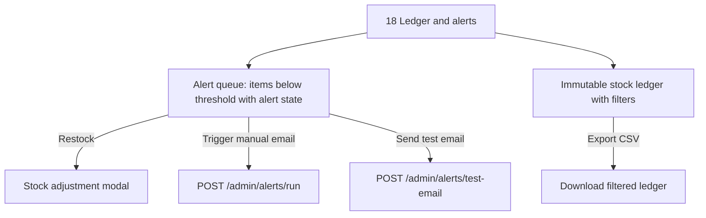

| Element | Behavior |
|---|---|
| System strip | Cron active/inactive, last run time, email relay status, transactions today |
| Alert queue | Items below threshold, quantity, threshold, last alerted time, state (pending, sent, cooling down). Actions: Restock, Emergency restock for out-of-stock items |
| Ledger | Immutable rows from `StockLog`: time, item, delta, reason (Order decrement, Manual restock, Correction, Wastage), order link, admin, quantity after. Filter chips and search by order or item; pagination; CSV export |
| Manual email / test email | Calls the same alert service as the cron job; results shown as a toast and logged |

---

## 5. End-to-End Sequence: Order to Delivery

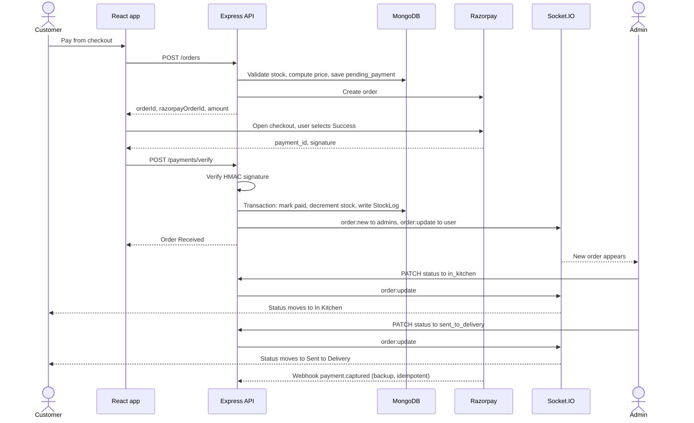

---

## 6. Low-Stock Alert Workflow

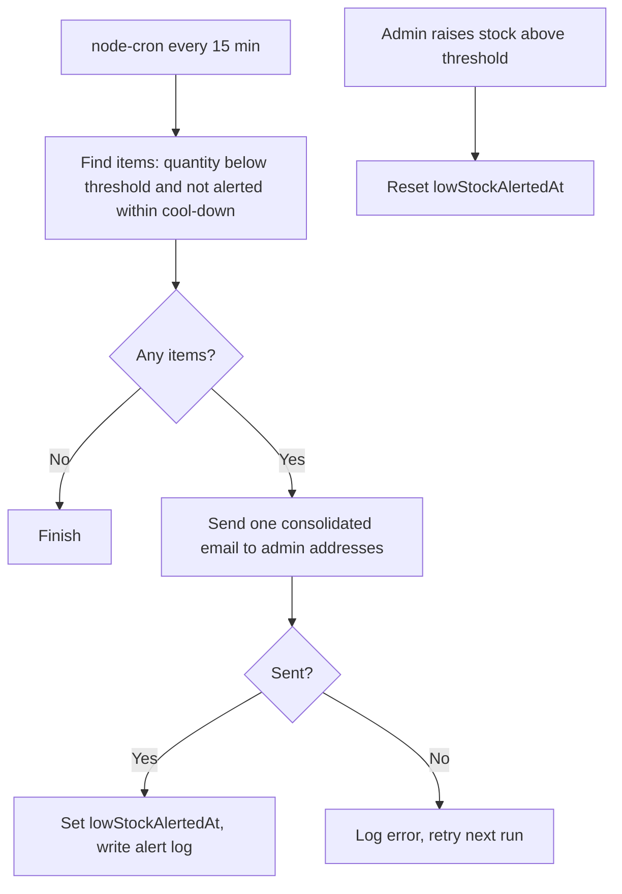

The same routine runs when an admin clicks **Run stock audit** or **Trigger manual email**.

---

## 7. Real-Time Events

| Event | From → To | Triggered by | UI effect |
|---|---|---|---|
| `order:new` | Server → `admins` room | Payment verified | New row and sound on pages 13 and 16 |
| `order:update` | Server → `user:<id>` room | Admin status change | Stepper, toast and LIVE badge on pages 7 and 10 |
| `order:update` | Server → `admins` room | Status change from another admin tab | Row syncs on pages 13, 16, 17 |
| `inventory:update` | Server → `admins` room | Order decrement or manual change | Watchlist, tables and chips on pages 13, 14, 18 |

Fallback: if the socket disconnects, customers poll `GET /orders/active` every 10 seconds and admins poll `GET /admin/orders?status=active`. After reconnect, refetch once.

---

## 8. Error and Edge-Case Matrix

| Situation | Where | Handling |
|---|---|---|
| Duplicate registration | Page 2 | Field error with login link |
| Login before verifying | Page 4 | Redirect to page 3, offer resend |
| Verification token reused or expired | Page 3 | "Link expired" and Resend |
| Resend spam | Pages 3, 5 | Cooldown timer plus server rate limit |
| Reset token invalid | Page 6 | Error and link to page 5 |
| Item sells out while in cart | Pages 7, 8, 9 | Disabled option, `OUT_OF_STOCK` message at checkout |
| Payment dismissed | Page 9 | Order stays `pending_payment`, retry allowed, no stock change |
| Browser closes after paying | Server | Webhook confirms the order; user sees it in page 10 |
| Double click on Pay or verify | Pages 9, API | Button locked; verify is idempotent via `payment.state` |
| Stock conflict after payment | API, page 17 | Order flagged `needsReview`, admin emailed, shown in lists |
| Two admins advance the same order | Pages 13, 16, 17 | Conditional update; the second gets `INVALID_TRANSITION` and the UI refreshes |
| Manual stock below zero | Page 18 modal | Rejected with a message |
| Socket disconnect | All live pages | Polling fallback and a "reconnecting" indicator |
| Admin lockout | Page 12 | 15-minute lock with message |
| Email provider failure | Pages 2, 3, 5 and cron | Logged; user can resend; cron retries next run |

---

## 9. Acceptance Walkthroughs

**Customer happy path (under 3 minutes)**
1. Register → open the verification email → verify → land on dashboard.
2. Build a custom pizza (base, sauce, cheese, vegetables) → add to cart.
3. Open checkout, confirm address → Pay → choose **Success** in Razorpay test mode.
4. See **Order Received** on the tracking page.
5. Admin moves it to **In Kitchen** then **Sent to Delivery**; the customer page updates without refresh.

**Admin happy path**
1. Log in at `/admin/login`.
2. See the new order live on the dashboard; advance its status.
3. Check inventory: ingredients used were decremented and a ledger row exists.
4. Lower a threshold or stock below it; run the audit; receive one consolidated email; raise stock and confirm the alert re-arms.
